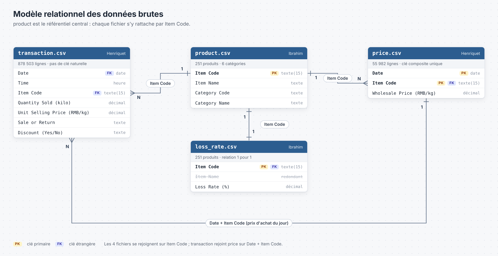
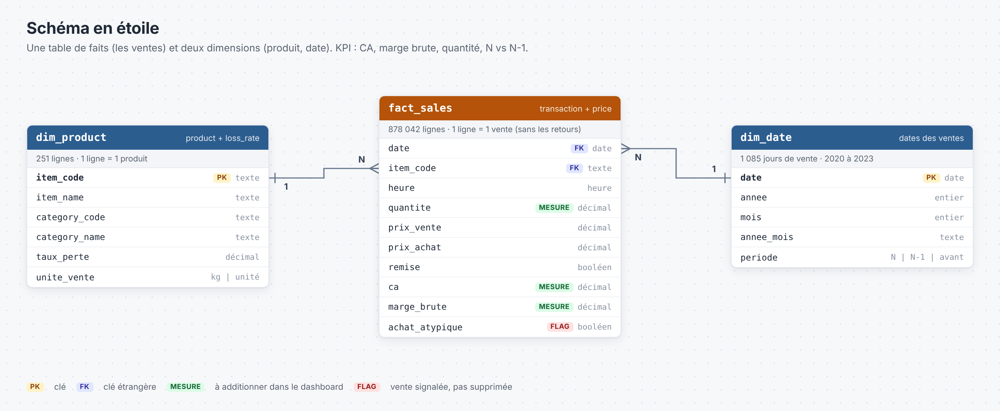

# Ventes de produits frais : nettoyage des données

Exercice 2, Data Analytics, Eugenia School. Binôme : **Henriquet** et **Ibrahim**.

Objectif : nettoyer les 4 fichiers reçus (`transaction.csv`, `product.csv`, `price.csv`, `loss_rate.csv`) pour alimenter un dashboard avec 3 KPI : **CA, marge brute, quantité vendue**, et leur évolution vs N-1.

- Période N : juillet 2022 à juin 2023
- Période N-1 : juillet 2021 à juin 2022

| Qui | Fichiers |
|---|---|
| Henriquet | `transaction.csv`, `price.csv` |
| Ibrahim | `product.csv`, `loss_rate.csv` |

---

## Étape 1 : diagnostic des fichiers

Dans les 4 fichiers : **aucune valeur manquante et aucun doublon exact**.

### transaction.csv (Henriquet) :

| Problème trouvé | Ce qu'on fait | Pourquoi (logique métier) |
|---|---|---|
| `Item Code` est lu comme un nombre | On le lit en texte | C'est un code produit, pas une valeur à additionner |
| 461 retours, avec une quantité négative | On les retire | Le CA et la quantité vendue se calculent sans les retours |
| Une vente de 160 le 2022-06-09 : ce sont 160 sachets de Xianzongye, d'habitude vendu par 1 | On la garde, avec une colonne `achat_atypique` (quantité de 20 ou plus) | On ne sait pas si c'est une erreur ou une grosse commande : on la signale sans la supprimer |
| Doublon probable le 2021-10-16 à 16:40:22.748 : même produit, même milliseconde, mais 0,565 kg et 0,578 kg | On garde les 2 lignes | Les poids sont différents, ce n'est pas un doublon exact (impact : 4,62 RMB) |
| Certains produits sont vendus au sachet ou à la boîte alors que la colonne dit "kilo" | Colonne `unite_vente` (kg ou unité) dans `dim_product` | Additionner des kilos et des sachets fausserait la quantité vendue |

### price.csv (Henriquet) :

| Problème trouvé | Ce qu'on fait | Pourquoi (logique métier) |
|---|---|---|
| `Item Code` est lu comme un nombre | On le lit en texte | C'est la clé de jointure avec les ventes |
| Rien d'anormal : un seul prix par jour et par produit, et chaque vente trouve son prix | On renomme seulement les colonnes | Ce prix d'achat sert à calculer la marge brute |

### product.csv (Ibrahim) : 

| Problème trouvé | Ce qu'on fait | Pourquoi (logique métier) |
|---|---|---|
| 4 noms avec un espace en trop à la fin | On retire l'espace | Sinon le même produit apparaît 2 fois dans un filtre |
| Un espace invisible dans la catégorie "Flower/Leaf Vegetables" | On le remplace par un espace normal | Sinon un filtre sur cette catégorie ne trouve rien |
| 4 noms en double sous 2 codes différents (ex : Broccoli) | On garde les 2 | Ce sont 2 produits différents : on analyse toujours par `Item Code` |

### loss_rate.csv (Ibrahim) :

| Problème trouvé | Ce qu'on fait | Pourquoi (logique métier) |
|---|---|---|
| `Item Name` est déjà dans product | On ne garde pas cette colonne | Un seul endroit pour le nom du produit |
| Le taux de perte est lu comme du texte (un espace après chaque valeur) | On le convertit en nombre | Pour pouvoir calculer avec |
| 22 produits à 0 % de perte, et 85 produits à 9,43 % (la moyenne de la colonne) | On les garde | À vérifier avec le métier : ce sont sûrement des valeurs par défaut |

---

## Étape 2 : modèle de données

### Modèle relationnel

- `product` est au centre : chaque fichier s'y relie par `Item Code`
- `transaction` se relie à `price` par `Date` + `Item Code` (le prix d'achat du jour)
- `loss_rate` a exactement un taux par produit (relation 1 pour 1)

### Schéma en étoile

| Table | Contenu | Construite avec |
|---|---|---|
| `fact_sales` | 1 ligne = 1 vente, avec CA et marge brute | transaction + price |
| `dim_product` | 1 ligne = 1 produit, avec sa catégorie, son taux de perte et son unité de vente | product + loss_rate |
| `dim_date` | 1 ligne = 1 jour, avec la période N ou N-1 | dates des ventes |

---

## Étape 3 : code de nettoyage

Langage : **SQL**, avec DuckDB.

| Fichier | Rôle | Qui |
|---|---|---|
| `sql/1_transaction.sql` | Nettoie transaction.csv | Henriquet |
| `sql/2_price.sql` | Nettoie price.csv | Henriquet |
| `sql/3_product.sql` | Nettoie product.csv | Ibrahim |
| `sql/4_loss_rate.sql` | Nettoie loss_rate.csv | Ibrahim |
| `sql/5_schema_etoile.sql` | Fait les jointures et crée fact_sales, dim_product, dim_date | les deux |
| `run.sql` | Lance les 5 fichiers dans l'ordre | |

**Lancer le projet :**

1. Mettre les 4 CSV dans le dossier `data/`
2. Installer DuckDB (une seule fois) : `winget install DuckDB.cli`
3. Dans le dossier du projet : `duckdb -c ".read run.sql"`

Résultat : `fact_sales.csv`, `dim_product.csv` et `dim_date.csv` dans `data/`, prêts pour le dashboard.

**Vérification :** on retrouve les chiffres de l'exercice 1.

| | N | N-1 | Évolution |
|---|---:|---:|---:|
| CA | 1 155 057 RMB | 930 519 RMB | +24,1 % |
| Marge brute | 447 119 RMB | 333 672 RMB | +34,0 % |

---

## Organisation Git

- `main` : la version finale
- `develop` : on y fusionne le travail des deux
- 4 branches, une par fichier : `feature/clean-transaction` et `feature/clean-price` (Henriquet), `feature/clean-product` et `feature/clean-loss-rate` (Ibrahim)
- Le dossier `data/` n'est pas sur Git (`.gitignore`) : `transaction.csv` fait 50 Mo
